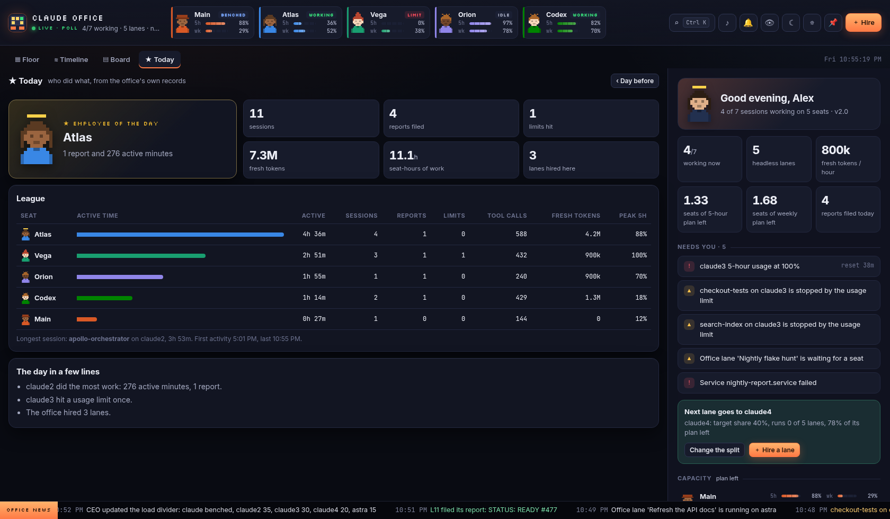
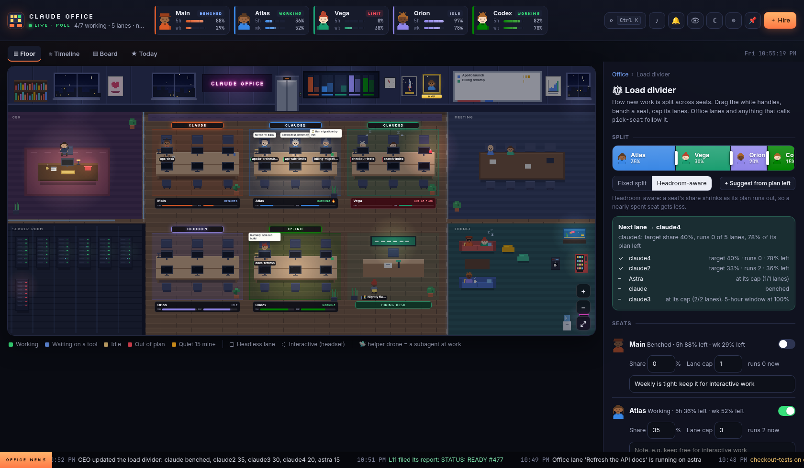

# Claude Office

A pixel-art office for every AI seat on your machine. Each Claude Code account gets a desk pod, and so does the
Codex CLI. Every running session is a worker at a desk, and what it is doing right now pops up over its head.
New sessions walk in from the elevator, finished ones walk out, and a seat that runs out of plan falls asleep.
You run the place from the CEO's office: see who is working, who is stuck and who is out of plan; split new work
across seats with a load divider; hire lanes from the front desk.


*Every screenshot here is demo mode (`--demo`): made-up seats, no real accounts.*

| Timeline | Today |
|---|---|
|  |  |
| **Load divider** | **A session up close** |
|  |  |

## The floor

- **One desk pod per seat.** `~/.claude`, `~/.claude2`, `~/.claude3`, ... are found automatically, plus
  `~/.codex`. A neon sign names the seat, and the nameplate shows its plan left as two health bars: the 5-hour
  window and the weekly allowance.
- **One worker per live session.** Workers act out what the session is doing:
  - typing for edits and commands
  - reading for reads and searches
  - a thought bubble while thinking
  - a progress bar on a long tool call
  - a question mark and a sweat drop after 15 quiet minutes
  - asleep with Zzz when the seat is out of plan

  Interactive sessions wear headsets. A subagent at work shows up as a little helper drone by the desk.
- **Arrivals and departures.** A new session walks out of the elevator to a free chair; a session that ends walks back.
- **Speech bubbles** pop up whenever a worker starts something new, and on hover.
- **Celebrations and alarms.** A filed report bursts into confetti with a "Shipped!" banner. A seat out of plan
  gets a spinning red beacon and its plate glows red.
- **The rooms:**
  - **CEO office:** the phone rings when something needs you, and the CEO paces when it is urgent.
  - **Wall TV:** plan left on every seat.
  - **Whiteboard and meeting room:** running programmes, with one representative per programme at the table.
  - **Server room:** one rack per conductor, supervisor or lane service; a failed rack throws sparks.
  - **Lounge:** idle seats have coffee, benched seats wear shades, and spent seats sleep on the couch.
    There's an aquarium too.
  - **Hiring desk:** office lanes waiting for a seat queue up here.
  - **Employee of the day:** a gold frame on the wall shows the day's MVP.
- **Lighting.** The windows follow your clock. At night the floor goes dark and monitors, desk lamps, neon and
  the aquarium light it; in the day, sunbeams come through the windows.
- **Camera.** Ctrl + scroll or pinch to zoom, drag to pan, double-click a desk to focus it.
  "Show on the floor" from any panel flies the camera to that seat or session.

## The CEO's tools

- **Briefing:**
  - live tiles
  - a "Needs you" list: logouts, seats near empty, sessions stopped by a limit, quiet lanes, blocked reports,
    failed services, and seats that will run dry before their reset at the current pace
  - capacity for every seat
  - the next-lane pick, with the reason
  - programmes and news
- **Seat view:** login health and tier, rings for plan left, and usage charts for the last 6 hours. A dashed
  line projects the current pace to the reset. The view also lists everyone at that seat's desks.
- **Session view:**
  - what it is doing right now, and what it is working on
  - its last steps, with icons
  - STATE notes and REPORT
  - tokens burned in the last hour, the last 5 hours and in total
  - the exact command to resume it
- **Timeline:** every session on every seat over the last 1 to 24 hours, coloured by state. It also shows usage
  lines, news markers, upcoming resets, and a ✕ where a seat runs out at its current pace.
- **Today:**
  - the employee of the day
  - a league table: active time, sessions, reports, limits, tool calls, tokens and peak usage per seat
  - a short plain-English digest of the day
  - a day picker for earlier days
- **Load divider:** drag the borders of the split bar to share new lanes between seats. Bench a seat, cap its
  lanes, and set usage guards. Choose **headroom-aware** mode, where a seat's share shrinks as its plan runs out,
  or **fixed** mode. Next to the controls you see who gets the next lane and what blocks every other seat. Scripts
  follow the divider too: `seat=$(claude-office pick-seat)` (exit code 3 when no seat is free).
- **Hiring desk:** start a lane from one of six templates (fix a test, investigate a bug, review a PR, docs,
  research, refactor), or re-hire a past lane.
  - Lanes run as systemd user units at low CPU priority with no display.
  - A lane keeps STATE notes. When its seat hits the usage limit, the seat rests until its reset and the lane
    resumes on the next seat the divider picks.
  - When the work is done, the lane files a REPORT.
- **Everything else:**
  - **Command palette (Ctrl/⌘ K):** jump to any seat, session or lane, or run any action.
  - **Checkpoint:** writes every session and its resume command to a Markdown file, for before a restart.
  - **Share-safe mode:** blurs interactive topics and emails for screen sharing.
  - **Board view:** the same information as cards.
  - **8-bit sound effects** and **desktop notifications**.
  - **Jarvis voice:** speaks short alerts through `jarvis-say` if it is on your PATH, with quiet hours.
  - **Themes:** dark, light or system; reduced motion is supported.
  - **Live updates:** a server-sent event stream, falling back to polling.

## Quick start

```bash
git clone https://github.com/JigarJoshi04/claude-office && cd claude-office
python3 -m office serve           # http://127.0.0.1:7420
python3 -m office serve --demo    # a made-up office, to look around safely
bin/install.sh                    # keep it running as a systemd user service
```

You need Python 3.10 or newer and nothing else: the server uses only the standard library, and the page needs no build
step. Linux is required for the live view, because sessions are read from `/proc` and lanes run under `systemd --user`.

Handy links: `/?view=timeline`, `/?view=stats`, `/#divider`, `/#hire`, `/#seat=claude2`, `/?theme=light`, `/?poll=1`
(skip the live stream).

## Command line

```text
claude-office status                 one line per seat and per session
claude-office pick-seat [--json]     the seat the divider gives the next lane
claude-office hire --title T --brief-file F [--workdir D] [--seat auto|ID] [--model opus]
claude-office lanes | stop ID | resume ID [--seat ID]
claude-office checkpoint             write the office down
```

## Configuration

Everything personal lives outside the repo, in `~/.config/claude-office/`:

| File | What it holds |
|---|---|
| `config.json` | Office and CEO name, seat labels, nicknames and colours, programmes (`{"match": "apollo", "name": "Apollo launch", "url": "..."}`), watched units, lane defaults and preamble, voice, checkpoint folder, port. The Settings panel edits the common parts. |
| `divider.json` | The load divider, written by the page |
| `token` | The per-install secret the page uses for writes |

The office keeps its own records in `~/.local/state/claude-office/`: the usage cache, 24 hours of minute
samples, and the news. Lanes and checkpoints go in `~/.local/share/claude-office/`.

## How it knows things

| What | Where it comes from |
|---|---|
| Seats | `~/.claude*/` folders that hold a login, plus `~/.codex` |
| Login health and tier | `.credentials.json` metadata: expiry and rate-limit tier. The tokens themselves never leave the server. |
| Usage | The plan's usage endpoint, called with the seat's current access token every few minutes. The office never refreshes a login itself, because a refresh would rotate the token under Claude Code. While a seat's token is expired, the office shows the last reading, marked stale. |
| Live sessions | `<seat>/sessions/<pid>.json`. A session counts only if the pid runs and its kernel start time matches, so a reused pid is never mistaken for it. |
| What a session is doing | Its transcript, read incrementally: only the new bytes since the last look. |
| History and stats | One sample per minute, kept for 24 hours |
| Codex seat | `~/.codex/sessions` rollouts and the rate limits Codex records |

## Safety

- The server listens on `127.0.0.1` only. It rejects any request whose `Host` is not loopback, which stops
  DNS-rebinding pages. Every write must carry the per-install token, which only the office's own page receives.
- A strict Content-Security-Policy is set. Every string from a transcript is escaped, and credential-shaped text
  is masked before it reaches the page.
- Credentials are read only at the moment of a usage call. They are never sent to the page, logged or cached.
- Demo mode reads no accounts and turns every write into a no-op.

## Uninstall

```bash
bin/install.sh --remove
rm -rf ~/.config/claude-office ~/.local/state/claude-office ~/.local/share/claude-office
```
