# Claude Office

[](https://github.com/JigarJoshi04/claude-office/actions/workflows/ci.yml) [](LICENSE)   

**Your AI coding seats, as a living office.** Every Claude Code account on your machine becomes a character with
its own room, and so does the Codex CLI. Every running session is a little worker at a desk in that room, acting out
what it is doing right now. New sessions walk in from the elevator; spent seats nap on the couch. You run the place from the CEO's chair: see who is
working and who is stuck, talk to any task, split new work across seats, and hire background lanes from the front
desk.

And the office grows with the work: characters level up and earn gear, the office itself levels up and unlocks palms,
a robot vacuum, a dog and fireworks, and there are daily goals, a weekly "beat last week" challenge, combos, gifts
with stickers to collect and badges to chase. Replay the day on the floor, put it on a spare screen in TV mode, or share a picture of the day.

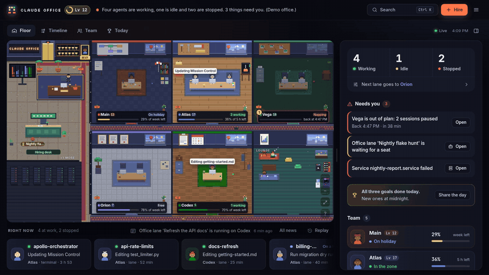

*Every screenshot and recording is demo mode (`python3 -m office serve --demo`): made-up seats, no real accounts.*

| The floor | Talk to a task | Your team |
|---|---|---|
| 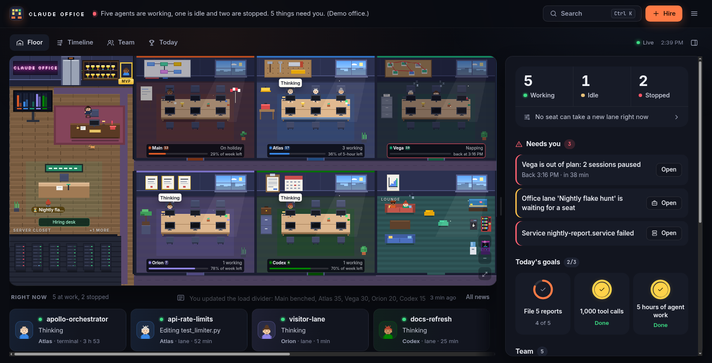 | 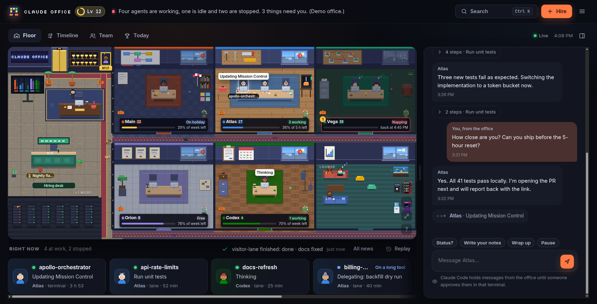 | 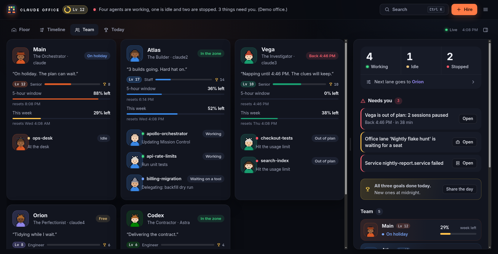 |
| **Level up** | **Trophy room** | **Trophy wall** |
| 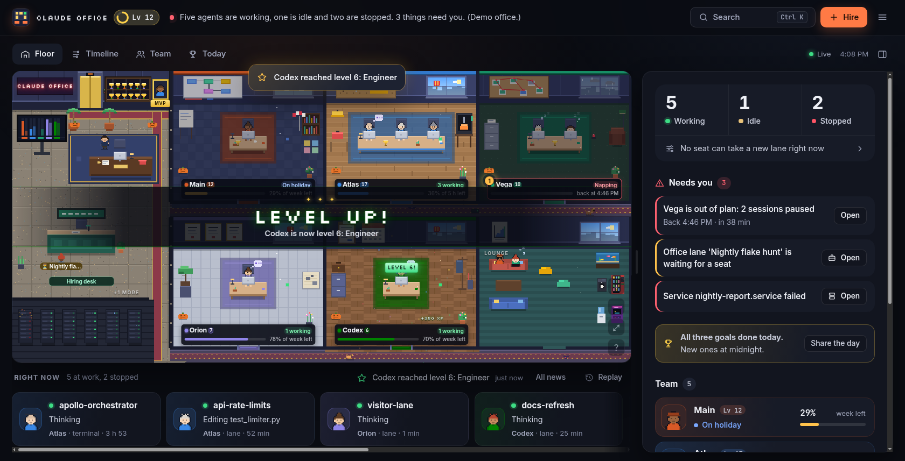 | 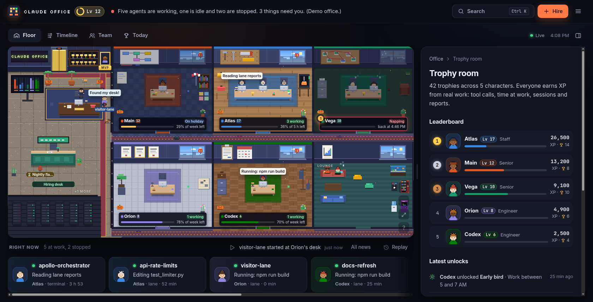 | 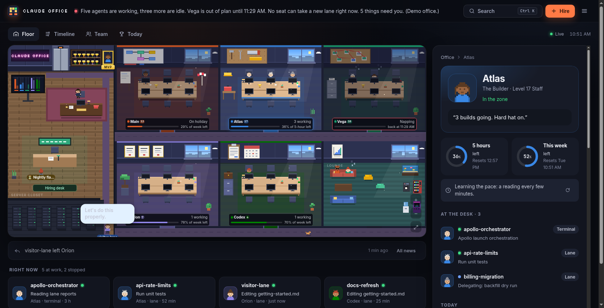 |
| **Room peek** | **Day theme** | **Timeline** |
| 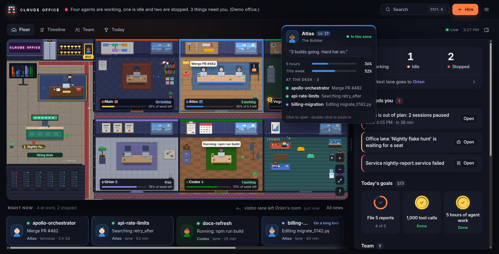 | 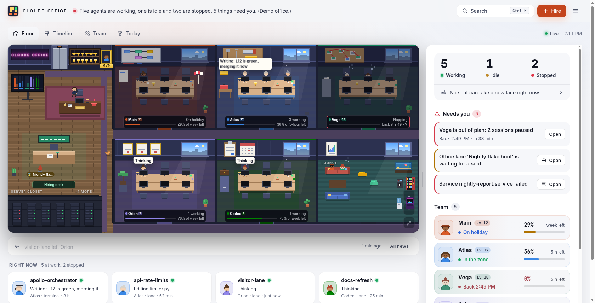 | 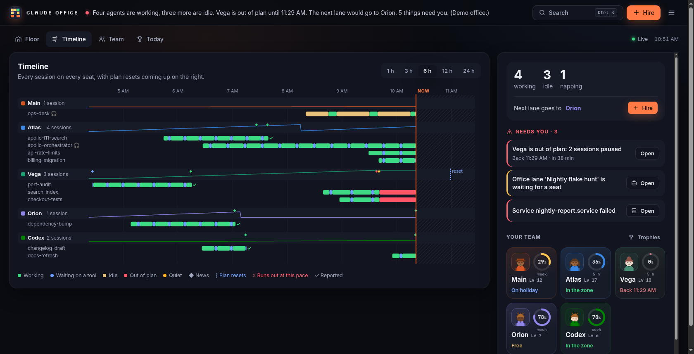 |
| **Replay the day** | **TV mode** | **The office levels up** |
| 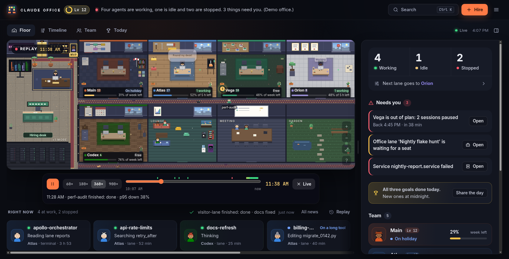 | 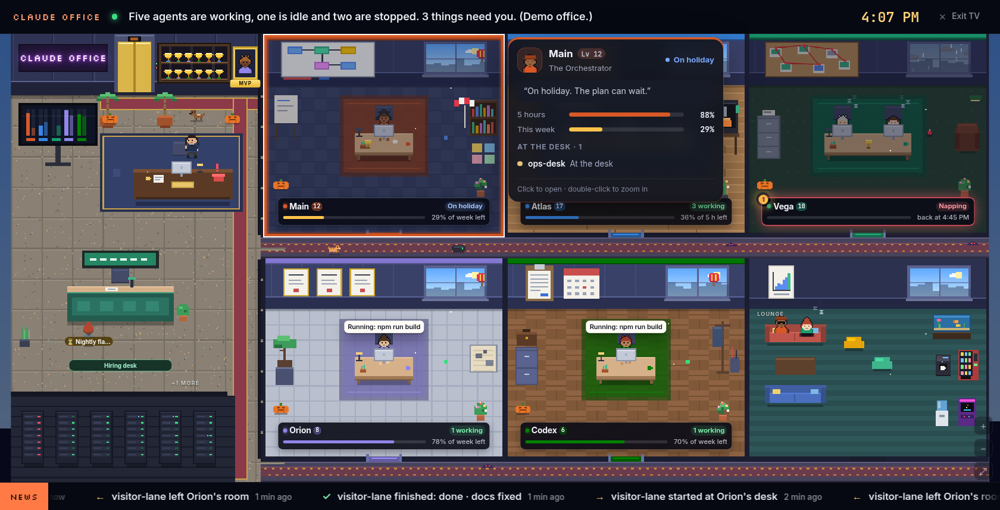 | 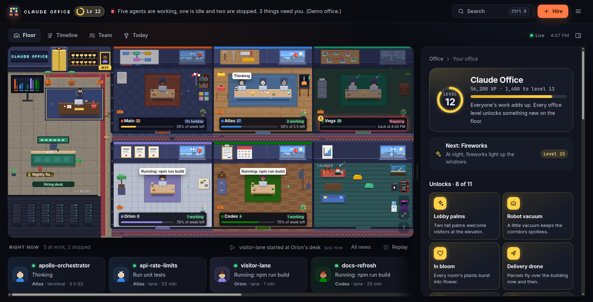 |

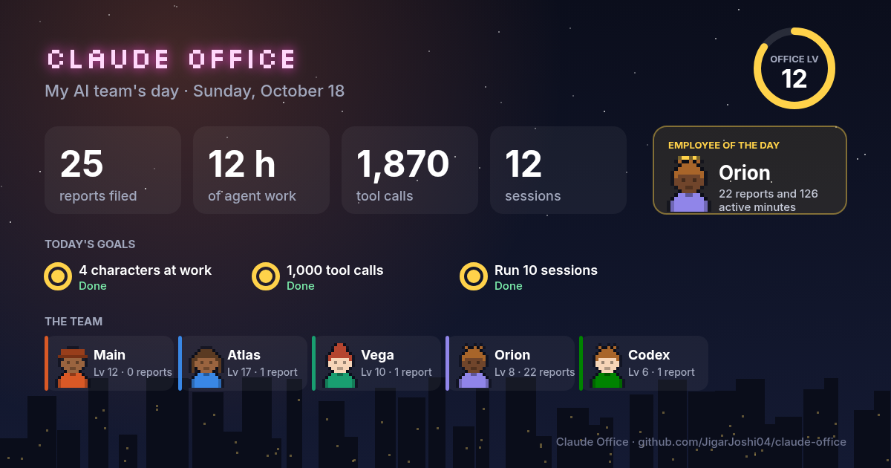

## Why

If you run several Claude Code accounts (and maybe Codex) at once, the questions are always the same: *Is anything
working? What is each one doing? Which seat is about to run out, and when does it reset? Where should the next job
go?* Claude Office answers them in one glance, in plain English, and lets you act on the answer.

## What's inside

**A living floor: a room per character**
- Every seat, found automatically (`~/.claude`, `~/.claude2`, … and `~/.codex`), gets its own room. The room has its
  name on the door, a floor in its colour, a window, and decor that matches its personality. The Investigator has a
  corkboard with red string, the Builder a tool pegboard and a hard hat, the Night Owl a moon poster, string lights
  and a coffee machine, and so on.
- One worker per live session, at a desk sized to the people actually there (one, two, three, four or six seats) on
  a rug in the seat's colour. They type, read, think, wait on long tools, sweat when stuck, and fall asleep when their
  seat is out of plan. Terminal sessions wear headsets; a subagent shows up as a little helper drone.
- Every personality has its own floor (oak planks, carpet tiles, library green, pale tiles, a starry navy carpet, a
  chequered floor, parquet) and its own furniture corner: a 3D printer, an armchair under a lamp, a sand garden.
- Rooms tell you their state at a glance: lights on while people work, dim while the seat naps (with when it is back),
  a beach umbrella when it is on holiday, a padlock on the door when it is logged out. Each nameplate shows the name,
  level, a coloured status chip and the plan left, with a pulsing badge when something about that seat needs you.
- **Room peek**: hover a room for a moment and a card shows its voice, both plans and who is doing what. The `?` by the
  camera buttons explains every colour, badge and icon on the floor.
- A lobby holds the elevator, the CEO's desk with the capacity board, the hiring desk, the trophy cabinet and the
  server closet. A spare room becomes the lounge, where seats on a break hang out.
- Arrivals walk in from the elevator, down the corridor and through their room's door. Filed reports burst into
  confetti, and night lighting follows your clock. Pixel the office cat wanders the corridors and naps in the lounge;
  click her for a tip.
- The building fits your screen. On a desktop window the office fills it edge to edge: the floor re-plans itself
  (two, three or four rooms to a row, taller rooms) for whatever space it has, spare cells become gardens, and a
  little night city fills anything left. Drag the inspector wider and the building rearranges itself live.
- Under the floor, a dock shows everyone at work right now: who, what they are doing and for how long. A click
  opens their chat and flies the camera to their desk.
- Zoom and pan the camera (a minimap appears while zoomed), double-click a room to fly to it, right-click it for quick
  actions: open, zoom in, hire a lane for that seat, send it on holiday, copy its terminal command. Point at a character anywhere (the team list, the dock,
  a room) and their room lights up on the floor while their row lights up in the list.
- Every room has its own weather: its window rains while the seat is out of plan and clouds over while its plan runs
  low.
- **Replay** (`R`): the floor plays back the last 6 or 24 hours from the office's own history, at up to 900×. People
  come and go, reports burst into confetti and level-ups get their banner as they happened; scrub with the timeline,
  `Space` pauses, the arrows step, `Esc` returns to live.
- **Install it as an app** (☰ → Install as an app, in Chrome or Edge): its own window, and a badge on its icon with the
  number of things that need you.
- **TV mode** (`V`, or open `/?tv=1` on a spare screen): the floor alone, full screen, with a status strip and a clock,
  while a slow tour lights up each room and shows its card.

**The office levels up**
- Everyone's XP adds up to an office level (the gold ring next to the name). Each level unlocks something on the floor:
  lobby palms, a robot vacuum, flowers in every room, a delivery drone, gold elevator doors, Biscuit the office dog, a
  neon show, a hot-air balloon, fireworks at night, gold nameplates and a golden statue of you. "Your office" lists
  them all, what comes next and who built the most.
- **Beat last week**: a weekly challenge to file 10% more reports than last week, with a Record week celebration.
- **The day's rhythm**: a morning card recaps yesterday and names today's goals; an evening card wraps the day up.
- **Gifts and a sticker album**: a report or a finished lane sometimes leaves a gift box in that character's room,
  and a delivery waits at the CEO desk every morning. Open them for 24 pixel-art stickers in four rarities; five
  spares swap for a rare-or-better gift. Only one sticker is Legendary. Finishing all goals, a big combo or a level
  up always brings a gift, a daily happy hour doubles the odds, and each finished rarity puts something on the floor.
- **Tokens** (K): every token since the oldest transcript on the machine, by range (today to all time) and per
  character: who burns the most and who moved, a calendar, the hours of the week, records, the hungriest sessions,
  projects and models, what it shipped (commits, PRs, lines, tokens per commit), CSV export, and a live burn meter. Counted from the transcripts and attributed to the seat that
  ran each session.
- **Shipped work earns XP**: commits (25), pushes (5), opened (50) and merged (150) pull requests, read from the
  transcripts, with "+3 commits" rising from the desk and five shipping achievements.
- **Task lists**: a session's own task list as a progress bar on the back of its screen and a checklist on its page.
- **Prompt cache countdown**: a waiting session shows how long its prompt cache stays warm ("Cache warm 4:12") and
  what a reply saves before it cools; its mug steams on the floor until then.
- **API value**: every response priced at Anthropic's and OpenAI's list prices (5-minute and 1-hour cache writes,
  cache reads, output, fast mode), per character, model, project, day and month, against what the plans cost for the
  same days: "$9,030 at API list prices, 15× what the plans cost". A plan is priced by its tier (Pro, Max 5x, Max 20x)
  unless you set it per character in Settings.
- **Character cards**: each character as a collectible card, framed Bronze to Holo by level, to save or post.
- **Your week in review**: on Mondays (or from the menu) the last seven days play as a short story, ending in a
  picture to post: reports against the week before, agent hours, the star of the week and what you collected.
- **Office radio**: press M (or click the boombox on the CEO desk) for endless lo-fi, made up as it plays. No files,
  nothing fetched.
- **Bug Squash**: the lounge's arcade cabinet plays a 30-second game of squashing bugs (not features) on a code
  editor, for a gift when you beat your best.
- **Badges for you**: nineteen of them (one a secret), from *Inbox zero* and *Hiring manager* to *Collector* and *Night owl*.
- **Seasons**: pumpkins and bats for Halloween, lamps and a rangoli for Diwali, a tree and snow in December.
- **Combos**: reports and finished lanes within 15 minutes of each other chain into a combo (×2, ×3, …) with a timer
  draining on the floor and rising chimes.
- **Today's card**: one picture of the day (reports, hours, tool calls, employee of the day, goals, streak and the
  team) to save or copy into a post or a channel. Only names, levels and counts go in.

**Every seat is a character**
- A name, a role, a motto and a few traits ("Atlas, The Investigator: *Show me the evidence.*"). You can rename them
  and change their colours in Settings.
- They talk about themselves in their own voice ("Napping until 11:10. The clues will keep.", "3 builds going. Hard
  hat on.") and write a one-line diary of their day.
- Pick a personality for each one in Settings (or keep the automatic one): it sets their voice, their floor and their
  furniture.
- They speak up when it matters: when they arrive, when they ship, when they hit a limit, and when a fresh window
  opens. Now and then two of them trade a line about what is going on. Teammates react too: they cheer a report or a level-up, and offer to cover when someone runs out of plan.
- A career that grows with real work. XP comes from tool calls (1 each), minutes at work (2), sessions (10) and
  filed reports (100). Levels run from Intern to Legend, with a "LEVEL UP!" banner across the floor and "+XP"
  rising from busy desks.
- Desks upgrade as their character levels up: a mug, a plant, a gold cup, a glowing desk edge, a pennant, gold
  trim. Their people get gear too: a team badge, caps in the seat's colour, sunglasses and gold headphones.
- Fifteen achievements, such as *Night shift*, *Marathon*, *Juggler* and *Week streak*. They sit on each
  character's trophy wall with a "next up" goal, and fill the trophy cabinet in the lobby. The cabinet opens
  the Trophy room, with an XP leaderboard.

**Talk to a task**
- Open any session and use the **Chat** tab. It shows the conversation: prompts, replies (formatted: lists, code,
  tables), collapsed tool steps, messages from other sessions, and replies sent to you.
- Send a message from the office. Lanes you hire here get it straight away. Terminal sessions hold it for approval
  at that terminal, because that is Claude Code's own safety rule and the office respects it.
- Agents can answer you: the office has its own inbox, and replies show up in the chat and as a toast.
- **Find** anything in a conversation: matches are highlighted and Enter jumps between them.
- **Follow up** on a finished session. Your message starts a lane that resumes that exact conversation.
- **Message all lanes** at once, for example "limits reset in 20 minutes: write your notes now".

**The CEO's briefing**
- Always in the same order: how many sessions are working, idle and stopped (and who gets the next lane), what
  needs you, today's goals, and your team.
- *Needs you*, grouped per seat ("Vega is out of plan: 2 sessions paused"), and each item with a one-click fix: copy
  the login command, open the chat, open the lane.
- Your team as one row per character: face, level, mood in a word, and a bar for the plan it has left.
- **Today's goals**: three new targets every day, drawn from six kinds (reports, tool calls, agent hours, sessions,
  lanes hired, characters at work) at three difficulties, as rings. Finishing one
  celebrates on the floor; finishing all three every day builds a streak.
- *While you were away*: after an hour or more away, one line says what happened since you last looked (reports
  filed, level-ups, trophies, lanes finished, limits hit, anything blocked); open it for the items to read first.
- News reads like people talk: "tpl-fix finished: ready for review · #1679", "visitor-lane started at Orion's desk".
- Each character's page: its voice and two plan rings with their resets, then three tabs: **Now** (who is at the
  desk, today's diary, the plan chart), **Career** (level, stats, trophies) and **Settings** (duty, terminal command,
  account).
- **Resizable**: drag the handle between the floor and the inspector, or focus it and use the arrow keys.
  Double-click puts it back. The width is remembered, and the inspector lays itself out for the space it has.
  Hide it with the button by the clock (or `\`) for a full-width floor; opening anything brings it back.
- **Text size**: Auto, Small, Medium, Large or Extra large, from the menu or Settings. Auto uses larger text on big
  screens, so a 27-inch monitor reads as well as a laptop.
- Keys: `1`–`9` open characters, `Esc` goes back to the briefing, `?` lists the rest.

**Views**
- **Timeline**: every session on every seat over the last 1 to 24 hours, coloured by state. It also shows usage,
  news markers, upcoming resets, and a ✕ where a seat runs out at its current pace.
- **Team**: persona cards with both plan windows and everyone at each desk.
- **Today**: the last seven days as a chart (reports, agent hours or tool calls, against the week before), employee of
  the day, a league table (time at work, sessions, reports, limits, tool calls, tokens, peak
  usage) and a short digest of the day.

**Running the office**
- **Load divider**: drag the borders of the split bar to share new lanes between seats. Send a seat on holiday, cap
  its lanes, or set usage guards. Adapt-to-plan mode shrinks a seat's share as its plan runs out. Scripts follow it
  too: `seat=$(claude-office pick-seat)`.
- **Hiring desk**: six brief templates, plus your own (Save as a template).
  - Lanes run as low-priority background services.
  - A lane keeps notes, moves to another seat if its seat hits a limit, and files a report when done.
  - You can stop, resume, re-hire or chat with any lane.
- **Checkpoint**: writes every session and its resume command to a file, for before you restart.
- **Save a picture of the office**: a PNG of the floor with each character's level and status. It has no session
  names or accounts in it, so it is safe to post.
- **Everything else**: Ctrl/⌘ K command palette, share-safe mode for screen sharing, 8-bit sound effects, desktop
  notifications, optional Jarvis voice alerts, a day theme, and reduced motion.

## Quick start

```bash
git clone https://github.com/JigarJoshi04/claude-office && cd claude-office
python3 -m office serve --demo    # look around a made-up office first
python3 -m office serve           # your real office at http://127.0.0.1:7420
bin/install.sh                    # keep it running as a systemd user service
```

You need Python 3.10 or newer and nothing else: the server uses only the standard library, and the page needs no
build step. The live view needs Linux, because sessions are read from `/proc` and lanes run under `systemd --user`.

Handy links: `/?view=timeline`, `/?view=board`, `/?view=stats`, `/#hire`, `/#divider`, `/#trophies`, `/#seat=claude2`, `/?theme=light`.

## How talking to a session works

Claude Code sessions listen on a private Unix socket for messages from other sessions (the mechanism behind its
SendMessage tool). The office writes the same one-line frame to that socket. The message is labelled as coming from
"Claude Office (CEO)", and the office's own inbox socket is given as the reply address.

The receiving session decides what happens:

| Session | What happens |
|---|---|
| A lane hired from the office, with "Let me message it" on (the default) | Started with `crossSessionInbound: "accept"`, so the message is delivered straight away |
| A terminal session | Held. The terminal shows "Held message from another session" until someone approves it there |
| A finished session | The office starts a follow-up lane: `claude --resume <id> -p "<your message>"` |

The office never claims a permission mode, so it cannot get around that review.

## Command line

```text
claude-office status                 one line per seat and per session
claude-office pick-seat [--json]     the seat the divider gives the next lane (exit 3 when none can)
claude-office hire --title T --brief-file F [--workdir D] [--seat auto|ID] [--model opus]
claude-office lanes | stop ID | resume ID [--seat ID]
claude-office checkpoint             write the office down
```

## Configuration

Everything personal stays outside the repo, in `~/.config/claude-office/`:

| File | What it holds |
|---|---|
| `config.json` | Office and CEO name, seat names, roles, mottos and colours, programmes (`{"match": "apollo", "name": "Apollo launch", "url": "..."}`), watched services, lane defaults and preamble, voice, checkpoint folder, port. The Settings panel edits the common parts. |
| `divider.json` | The load divider, written by the page |
| `token` | The per-install secret the page uses for writes |

The office keeps its own records in `~/.local/state/claude-office/`: the usage cache, 24 hours of minute
samples, the news, the message log and each seat's career. Lanes and checkpoints go in `~/.local/share/claude-office/`.

## News from your scripts

Deploy scripts, make targets, cron jobs and CI runners can put news on the floor: a toast, a line in the news, a
marker on the seat's timeline, and with `--banner` a banner across the floor.

```sh
python3 -m office post "Prod deploy done: v2.4.1" --level good --source deploy --banner
python3 -m office post "Nightly build failed" --level bad --source CI --seat claude2
```

Or straight over HTTP, with the per-install token (readable only by you):

```sh
curl -X POST http://127.0.0.1:7420/api/event -H "Content-Type: application/json" \
  -H "X-Office-Token: $(cat ~/.config/claude-office/token)" \
  -d '{"text": "Backup finished", "level": "good", "source": "cron"}'
```

`level` is good, info, warn or bad; `seat` puts it at a character's desk; at most 30 events a minute.

## A status line for your terminal

`GET /api/status.txt` returns one line: how many sessions work, what needs you, the burn and the tightest plan
(`?style=plain` drops the symbols). For tmux:

```
set -g status-right '#(curl -s 127.0.0.1:7420/api/status.txt?style=plain)'
```

## How it knows things

| What | Where it comes from |
|---|---|
| Seats | `~/.claude*/` folders with a login, plus `~/.codex` |
| Plan usage | The plan's usage endpoint, called with each seat's current access token every few minutes. The office never refreshes a login itself; while a seat's token is expired, it shows the last reading, marked stale. |
| Live sessions | `<seat>/sessions/<pid>.json`. A session counts only if its pid runs and its kernel start time matches. |
| What a session is doing | Its transcript, read incrementally |
| History and stats | One sample a minute, kept for 24 hours |
| All-time tokens | The `usage` of every response in the transcripts, read once and then incrementally; a session's seat from its `session-env` folder |
| API value | Each response's `usage` (cache write split, speed, inference region) at the list prices in `office/prices.py` |
| Codex seat | `~/.codex/sessions` rollouts and the rate limits Codex records. Codex lanes run `codex exec` with a workspace-write sandbox (or a `gpt` wrapper, when one is installed). |

## Safety

- **Network:** the server listens on `127.0.0.1` only, and rejects any request whose `Host` is not loopback.
- **Writes:** every write needs the per-install token, which only the office's own page receives.
- **The page:** a strict Content-Security-Policy is set. Transcript text is escaped, and credential-shaped strings
  are masked before they reach it.
- **Credentials:** read only at the moment of a usage call. They are never sent to the page, logged or cached.
- **Messages:** the office's inbox accepts only connections from your own user. It never claims a permission mode,
  and it never sends a message without your action.
- **Demo mode:** reads no accounts, and every write does nothing.

## Uninstall

```bash
bin/install.sh --remove
rm -rf ~/.config/claude-office ~/.local/state/claude-office ~/.local/share/claude-office
```
